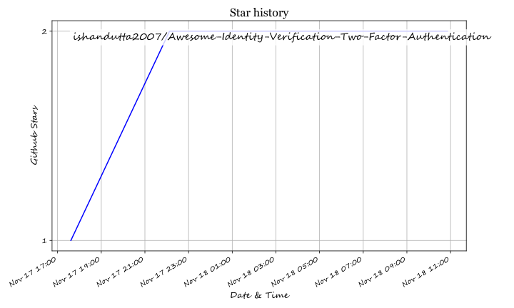

  

# 🔐 Awesome Identity Verification & Two-Factor Authentication

  
  
  
  
  
  
  

> 🛡️ A meticulously curated directory of top-tier SaaS platforms and open-source GitHub projects for Identity Verification (IDV), Know Your Customer (KYC), Multi-Factor Authentication (MFA), Two-Factor Authentication (2FA), Passkeys (FIDO2/WebAuthn), and Authenticator Apps.

---

## 📑 Table of Contents

- [📊 Sector Overview & Market Dynamics](#-sector-overview--market-dynamics)
- [🏢 SaaS & Hosted Platforms](#-saashosted-platforms)
- [💻 Open-Source GitHub Projects](#-open-source-github-projects)
  - [⭐ Open-Source Solutions by Stars_Count](#-open-source-solutions-ranked-by-github-stars)
  - [🏗️ Architecture & Implementation Guide](#-architecture--implementation-guide)
- [🤝 Support](#-support)
- [🚀 How to Contribute](#-how-to-contribute)
- [⚠️ Disclaimer](#-disclaimer)
- [⭐ Star History](#-star-history)

---

## 📊 Sector Overview & Market Dynamics

The global Identity Verification (IDV) market is projected at **$15.5B – $16.5B in 2026** (scaling from ~$13.5B in 2025 at ~14% CAGR), while the broader Multi-Factor Authentication (MFA) and Identity & Access Management (IAM) software market surpasses **$20B+** (growing at ~17% CAGR). 

The sector exhibits **moderate fragmentation** across distinct sub-verticals rather than a single winner-take-all monopoly:
- **Workforce IAM & Cloud MFA** is moderately concentrated among hyperscalers and enterprise suites (Microsoft Entra ID, Cisco Duo, Okta, Ping Identity).
- **Consumer IDV / KYC Verification** remains highly competitive and regionally fragmented due to country-specific compliance regulations, document formats, and fraud profiles (featuring Persona, Trulioo, Entrust/Onfido, and Veriff).
- **Passwordless & Passkeys (FIDO2/WebAuthn)** represent the fastest-growing convergence layer across both enterprise hardware (Yubico) and open-source identity infrastructures.

---

## 🏢 SaaS/Hosted Platforms

The table below summarizes leading commercial SaaS and hosted identity verification and multi-factor authentication platforms. It includes starting pricing tiers, specific free tier or trial constraints, and estimated enterprise scale (market cap, valuation, or annual revenue), sorted in descending order of company size.

| Platform | Category / Focus | Starting Tier Price | Free Tier / Trial Limit | Company Scale (Market Cap / Valuation / Revenue) |
| :--- | :--- | :--- | :--- | :--- |
| **[Microsoft Entra ID](https://www.microsoft.com/en-us/security/mobile-authenticator-app)** | Cloud IAM, MFA & Microsoft Authenticator | **$0** (Free tier included with cloud subscriptions; P1 starts at **$6.00/user/month**, P2 at **$9.00/user/month**) | **Free forever plan**: Includes Security Defaults (tenant-wide mandatory MFA via Microsoft Authenticator) up to directory object caps (50,000–300,000 objects); no custom conditional access without P1/P2 | ~$3.8T – $4.0T Market Cap (Parent: Microsoft Corporation) |
| **[Duo Security](https://duo.com/)** | Adaptive MFA, SSO & Passwordless Trust | **$3.00/user/month** (Duo Essentials; Advantage tier at **$6.00/user/month**, Premier at **$9.00/user/month**) | **Free forever plan**: Capped at **up to 10 users** max with Duo Mobile app push/OTP and basic app integrations; 30-day trial for paid tiers | ~$375B – $410B Market Cap (Parent: Cisco Systems) |
| **[Authy / Twilio Verify](https://authy.com/)** | 2FA Mobile App & Verification APIs | **$0.05 per successful verification** (plus telecom delivery fees, e.g., ~$0.0083/SMS in US) | **Free trial**: **30-day trial with initial testing credits** (restricted to pre-verified test phone numbers and default destination filters) | ~$30B – $33B Market Cap (Parent: Twilio Inc.) |
| **[Okta Verify](https://www.okta.com/)** | Enterprise Workforce & Customer IAM / MFA | **$6.00/user/month** (Starter Workforce tier, billed annually with a **$1,500/year minimum contract**) | **30-day free trial**: Limited to **up to 10 active users**, 1 admin account, and 5 active workflows | ~$30B – $32B Market Cap (Okta Inc.) |
| **[Zoho Directory / OneAuth](https://www.zoho.com/directory/)** | Workforce Identity, MFA & Authenticator | **$1.70/user/month** (Standard plan; Professional plan at **$5.95/user/month**) | **Free forever plan**: Capped at **up to 10 users**, maximum 3 third-party apps, default roles only, and 7-day audit log retention | ~$12B – $15B Est. Private Valuation (~$1.5B FY25 Revenue, Zoho Corp.) |
| **[Ping Identity](https://www.pingidentity.com/)** | Enterprise CIAM, Workforce MFA & Risk Auth | **$3.00/user/month** (Entry Cloud MFA/SSO package; enterprise packages often require annual commitments or $35k+ baseline ACV) | **30-day free trial**: Sandbox environment access with DaVinci orchestration rate limits and non-production testing caps | ~$2.8B Acquisition Valuation (Private Equity: Thoma Bravo) |
| **[Persona](https://withpersona.com/)** | Identity Verification (IDV), KYC & Biometrics | **$250.00/month** (Essential Plan, annual commitment; includes 500 services/month + $1.50/overage check) | **Free sandbox/developer tier**: Full developer environment for workflow prototyping; startup program provides up to 500 free checks/month upon application | ~$2.0B Valuation (Series D Funding Round) |
| **[Trulioo](https://www.trulioo.com/)** | Global KYC, AML & Electronic Identity Proofing | **$99.00/month** (Baseline entry tier; typical production rates range **$0.50 – $2.50 per verification check** based on volume & jurisdiction) | **No free tier**: API developer demo/sandbox access provided upon request for integration testing (simulated verifications only) | ~$1.75B Valuation (Series D Funding Round) |
| **[Yubico](https://www.yubico.com/)** | Phishing-Resistant FIDO2/WebAuthn Hardware & IAM | **$45 – $95 per physical YubiKey** (Enterprise as a Service subscription begins around **$2.50 – $4.00/user/month** with a 500-user minimum) | **No self-serve free trial** (Physical security hardware; evaluation units and sales PoC test units provided for qualified enterprise evaluations) | ~$1.4B – $1.5B Market Cap (Nasdaq Stockholm: YUBICO.ST) |
| **[Onfido](https://onfido.com/)** | AI Document Verification & Liveness Detection | **$1.00 – $3.00 per verification check** (Tiered volume pricing with annual enterprise commitments) | **No public free tier**: Enterprise demo sandbox with test API credentials and synthetic document samples | ~$1.0B+ Est. Valuation (~$1.0B+ Annual Revenue, Parent: Entrust) |

---

## 💻 Open-Source GitHub Projects

Open-source identity, multi-factor authentication, and passkey frameworks empower engineering teams to maintain full sovereignty over credentials, encryption keys, and self-hosted infrastructure.

### ⭐ Open-Source Solutions Ranked by GitHub_Stars

The following projects are actively maintained and sorted in descending order by GitHub stargazer count. Each repository link features a live Stars_Count badge linking directly to the project's stargazers.

1. **[Keycloak](https://github.com/keycloak/keycloak)**   
   Industry-standard Open Source Identity and Access Management (IAM) for modern applications and services. Provides full support for OpenID Connect, SAML 2.0, WebAuthn/Passkeys, TOTP, fine-grained access policies, and enterprise identity brokering.

2. **[Authelia](https://github.com/authelia/authelia)**   
   Lightweight, high-performance authentication and authorization server for self-hosted infrastructures and reverse proxies (Traefik, NGINX, Caddy). Features 2FA via FIDO2 WebAuthn passkeys, TOTP (Google/Microsoft Authenticator, Aegis), and Duo push notifications.

3. **[Authentik](https://github.com/goauthentik/authentik)**   
   Versatile, modern open-source Identity Provider focused on flexibility and ease of integration. Includes customizable login/stage execution flows, built-in MFA (TOTP, WebAuthn, SMS), LDAP/RADIUS gateways, and self-service account management.

4. **[Bitwarden Server](https://github.com/bitwarden/server)**   
   Backend infrastructure for Bitwarden password and credential management, offering enterprise-grade end-to-end encrypted vault storage, integrated two-step login (TOTP, FIDO2 WebAuthn, Duo, YubiKey), and zero-knowledge security architecture.

5. **[Zitadel](https://github.com/zitadel/zitadel)**   
   Cloud-native, multitenant identity infrastructure written in Go. Engineered for B2B multi-tenancy and passwordless authentication with native support for FIDO2/WebAuthn passkeys, OTP, machine-to-machine authorization, and audit trails.

6. **[SuperTokens](https://github.com/supertokens/supertokens-core)**   
   Modular open-source alternative to Auth0, Firebase Auth, and AWS Cognito. Provides developer-friendly SDKs for session management, passwordless OTP/magic links, multi-factor authentication, and social SSO.

7. **[Logto](https://github.com/logto-io/logto)**   
   Modern Auth0 alternative for web and mobile apps. Features out-of-the-box sign-in experiences, multi-factor authentication (SMS/Email OTP, TOTP, WebAuthn passkeys), role-based access control (RBAC), and unified customer identity.

8. **[Casdoor](https://github.com/casdoor/casdoor)**   
   UI-first, plug-and-play Identity and Access Management platform supporting OAuth 2.0, OIDC, SAML, WebAuthn, SMS/email verification codes, Face recognition verification, and multi-language admin interfaces.

9. **[Ory Kratos](https://github.com/ory/kratos)**   
   Headless, cloud-native identity management service written in Go. Implements core IAM primitives: passwordless authentication, WebAuthn/FIDO2 credentials, multi-factor authentication (TOTP, recovery codes), self-service profile registration, and account recovery.

10. **[Aegis Authenticator](https://github.com/beemdevelopment/Aegis)**   
    Secure, client-side, encrypted 2FA authenticator app for Android. Supports standard HOTP and TOTP algorithms, biometrics unlock, icon detection, encrypted JSON vault exports, and automatic backups without cloud dependencies.

11. **[Dex](https://github.com/dexidp/dex)**   
    OpenID Connect (OIDC) identity broker and connector engine. Acts as an authentication proxy to delegate verification to LDAP, SAML, GitHub, Google, or Keystone, frequently used as the authentication cornerstone for Kubernetes clusters.

12. **[Pocket ID](https://github.com/pocket-id/pocket-id)**   
    Minimalist, user-friendly OIDC identity provider built explicitly around passkeys (FIDO2/WebAuthn). Enables swift zero-password deployments for self-hosters and home-lab environments.

13. **[Hanko](https://github.com/teamhanko/hanko)**   
    Passkey-first authentication and user management API. Provides lightweight Web Components and SDKs to integrate FIDO2 passkeys, mobile biometrics, and email OTP verification flows in minutes.

14. **[Kanidm](https://github.com/kanidm/kanidm)**   
    Modern, fast, and secure identity management platform written in Rust. Replaces legacy LDAP/FreeIPA solutions with built-in WebAuthn/passkey support, OAuth2/OIDC, and rigorous security guarantees.

15. **[andOTP](https://github.com/andOTP/andOTP)**   
    Open-source two-factor authentication app for Android with encrypted backups (AES-256-GCM), custom categories, and multiple encryption methods (password, PIN, Android KeyStore). *(Note: Maintained primarily as an archival reference).*

16. **[SimpleWebAuthn](https://github.com/MasterKale/SimpleWebAuthn)**   
    Widely utilized TypeScript/JavaScript collection of server-side and client-side helper libraries for WebAuthn and passkeys. Simplifies credential registration, ceremony assertions, and authenticator attestation parsing.

17. **[privacyIDEA](https://github.com/privacyidea/privacyidea)**   
    Enterprise-grade modular multi-factor authentication server written in Python. Manages OTP tokens (TOTP, HOTP), WebAuthn devices, smartcards, SMS/email tokens, and 4-eyes authorization policies across heterogeneous environments.

18. **[FreeOTP (Android)](https://github.com/freeotp/freeotp-android)**   
    Two-factor authentication authenticator application developed originally under Red Hat. Utilizes open standards (HOTP RFC 4226, TOTP RFC 6238) with zero proprietary tracking.

19. **[FIDO2 .NET Library](https://github.com/passwordless-lib/fido2-net-lib)**   
    Comprehensive, FIDO2 / WebAuthn compliant open-source library for .NET, enabling passwordless authentication, security key registration, and attestation format verification in C#/.NET backend stacks.

20. **[Yubico YubiKey Manager](https://github.com/Yubico/yubikey-manager)**   
    Official command-line tool and Python library for configuring YubiKeys across FIDO2, WebAuthn, OTP, PIV, and OATH applications.

21. **[Python WebAuthn (py_webauthn)](https://github.com/duo-labs/py_webauthn)**   
    Pythonic WebAuthn server implementation developed by Duo Labs. Provides standard-compliant WebAuthn Relying Party support for registration and authentication verification.

22. **[Duo WebAuthn Go Library](https://github.com/duo-labs/webauthn)**   
    Go package for implementing WebAuthn and passkeys in Go web services, standardizing credential creation, authenticator responses, and session persistence.

23. **[FreeOTP (iOS)](https://github.com/freeotp/freeotp-ios)**   
    iOS counterpart of the FreeOTP authenticator project, providing open, token-based one-time password generation for Apple devices.

24. **[FIDO Alliance WebAuthn Demo](https://github.com/fido-alliance/webauthn-demo)**   
    Reference implementation and interactive demonstration application created by the FIDO Alliance to illustrate passkeys and WebAuthn specifications in real-world browsers.

25. **[Yubico libfido2](https://github.com/Yubico/libfido2)**   
    C library providing complete FIDO 2.0 / 2.1 functionality, enabling applications to communicate directly with hardware authenticators (YubiKeys and FIDO security tokens) over USB, NFC, and BLE.

26. **[Janssen Project](https://github.com/JanssenProject/jans)**   
    High-performance enterprise IAM platform curated by the Linux Foundation (evolution of Gluu Server), engineered for high-concurrency OAuth2/OIDC, FIDO2/UAF authentication, and Open Banking compliance.

27. **[LinOTP](https://github.com/LinOTP/LinOTP)**   
    Open-source modular one-time password (OTP) authentication server supporting multiple tokens, flexible backends, and enterprise authentication protocols.

28. **[Yubico python-fido2](https://github.com/Yubico/python-fido2)**   
    Official Python library for FIDO 2.0, FIDO U2F, and WebAuthn protocol communication with hardware tokens via USB and NFC.

---

### 🏗️ Architecture & Implementation Guide

When assembling an authentication and verification architecture:
- 🌐 **Full Identity Provider (IdP) & SSO**: Deploy **[Keycloak](https://github.com/keycloak/keycloak)**, **[Authelia](https://github.com/authelia/authelia)**, or **[Authentik](https://github.com/goauthentik/authentik)** to manage identity tokens, sessions, and MFA policies.
- 🔑 **Passkey & WebAuthn Integration**: Leverage **[SimpleWebAuthn](https://github.com/MasterKale/SimpleWebAuthn)** (Node.js/TS), **[py_webauthn](https://github.com/duo-labs/py_webauthn)** (Python), or **[fido2-net-lib](https://github.com/passwordless-lib/fido2-net-lib)** (.NET) to embed biometric and security key sign-ins into existing application codebases.
- 📱 **Client Authenticator Tools**: Use offline open-source authenticators such as **[Aegis](https://github.com/beemdevelopment/Aegis)** or **[FreeOTP](https://github.com/freeotp/freeotp-android)** for air-gapped, privacy-first OTP generation.
- 🪪 **Regulated Identity Verification (KYC/AML)**: While authentication mechanisms are abundantly available in open-source libraries, global identity proofing (verifying real-world government passports, driver licenses, AML sanctions screening, and biometric 3D liveness) generally requires commercial SaaS providers (**Persona**, **Trulioo**, **Onfido**) due to proprietary government registry connections and compliance liability.

---

## 🤝 Support

Thank you for visiting and supporting this curated resource! 💖

If you found this ecosystem guide helpful:
- ⭐ **Star this repository** to help others discover it.
- 🍴 **Fork and contribute** your favorite tools and libraries.
- 📢 **Share it** with peers, security engineers, and DevOps teams.
- ☕ If you'd like to support the ongoing research and maintenance, consider buying a coffee via the [GitHub Sponsors Dashboard](https://github.com/sponsors/ishandutta2007).

---

## 🚀 How to Contribute

Contributions are warmly welcome! Follow these steps to submit additions or improvements:

1. Fork the repository.
2. Add your entry in alphabetical order or sorted by relevant metrics in `README.md`.
3. Include: Product name, official link, precise starting pricing, free tier/trial boundaries, and relevant company size metrics. For open-source repos, include the social GitHub Stars_Badge.
4. Ensure descriptions are factual, objective, and neutral.
5. Submit a Pull Request with a clear summary of your changes.

---

## ⚠️ Disclaimer

This repository is community-curated for informational and architectural guidance. Identity verification, cryptographic token storage, and authentication protocols manage high-risk data and critical access control boundaries. Always perform independent compliance reviews (GDPR, HIPAA, KYC/AML, SOC 2, ISO 27001) and security audits prior to deploying authentication or verification stacks in production environments.

---

## ⭐ Star History

## ⭐ Star History

<a href="https://star-history.com/#ishandutta2007/Awesome-Identity-Verification-Two-Factor-Authentication&Timeline" align="center">
  <picture>
    <source media="(prefers-color-scheme: dark)" srcset="assets/ishandutta2007_Awesome-Identity-Verification-Two-Factor-Authentication_growth.svg">
    
  </picture>
</a>
